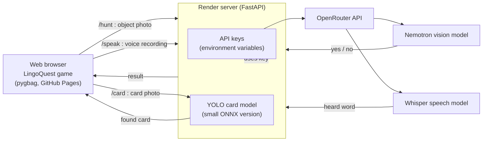

# LingoQuest

**A language-learning game where kids learn Japanese, French and Spanish words by listening, finding real objects, speaking, and showing cards to the camera, and collect passport stamps along the way.**

*Data Science Capstone, General Assembly. Nouf Almutawea.*

**Play it:** [LingoQuest web version](https://nalmutaweaa.github.io/Lingoquest-live/web/) (works in a browser, including on an iPad)
**Demo video:** [Watch the video]()

---

## Problem Statement & Motivation

Young children acquire new languages most easily early in life, yet most digital language-learning apps are built around screen-based flashcards and memorization. They ignore how children naturally learn, through playing, moving and exploring, and they give little feedback on what a child actually sees or says.

Many children today also grow up in multilingual households, hearing two or three languages from family and caregivers. Most apps do not reflect this reality, and families lack a playful, hands-on way to practice vocabulary that checks the child's answer in the real world.

Gen Alpha children are surrounded by technology, and research suggests that they pick up new languages faster when they start young. LingoQuest connects the words to the child's real surroundings (home, school and outdoors) using the camera and the child's own voice.

This project asks whether **computer vision** and **speech recognition** can turn everyday objects and spoken words into a **game that checks itself**.

## How the Game Works

The child picks a language and a country, travels there with a guide, and chooses one of three adventures: **Home**, **School** or **Outdoor**. Each adventure has three rounds, and each round is made of four games:

| Game | What the child does | Technology |
|---|---|---|
| **Learn** | Sees and hears each word | Vocabulary file, Edge TTS audio |
| **Speak** | Says the word out loud | Whisper speech recognition |
| **Hunt** | Finds the real object and shows it to the camera | Vision-language model |
| **Cards** | Holds up the printed card of the word | YOLO object detection |

Passing a round gives a bronze, silver or gold stamp in the child's **passport**. A **dictionary** lets the child revise all the words at any time.

## Dataset Description & Sources

**1. Custom image dataset (Cards)**
- **1,758 images** of **34 different classes**, covering the three adventures (for example apple, backpack, book, chair, clock, cup, car, tree and more)
- Personally collected photos, labeled and augmented using Roboflow
- Split: **82% training, 12% validation, 6% test**
- Augmentations applied: *(add the list from your Roboflow screenshot, for example flip, rotation, brightness, blur, noise)*

**2. Vocabulary dataset (`vocab_final.csv`)**
- Japanese, French and Spanish
- Three adventures (Home, School, Outdoor) with 10 words each
- Words, translations and pronunciation (Japanese kanji, hiragana and romaji)
- Multiple accepted word variations for speech matching
- Image and audio file paths, and the YOLO class for the card words

**3. Voice data**
- A default voice sample
- The child's recording, used for personalized voice generation (desktop version)
- Speech input for vocabulary recognition

## Model Architecture & Training Pipeline

| Component | Model / Service | Purpose |
|---|---|---|
| Object Detection | YOLO26s (Ultralytics) | Recognizes the printed vocabulary cards (Cards game) |
| Image Understanding | NVIDIA Nemotron 3.5 Super VL, through the OpenRouter API | Checks real objects in the camera image (Hunt game) |
| Speech Recognition | OpenAI Whisper (`whisper-large-v3`), through the OpenRouter API (paid, pay-per-use) | Recognizes the spoken word (Speak game) |
| Voice Cloning | HeyGen API | Personalizes the game guide's voice (desktop version) |
| Text-to-Speech | Edge TTS | Pronounces the vocabulary words |
| Game and camera | pygame, OpenCV | Game screens and webcam |
| Web version | pygbag (pygame in the browser), GitHub Pages | Runs the same game in any browser |
| Server | FastAPI on Render, ONNX Runtime | Hosts the API for the web version |

**Training pipeline (Cards):** photos of the printed cards, taken in different places and lighting → labeled and augmented in Roboflow → split into training, validation and test sets → YOLO26s trained on Google Colab (T4 GPU) with Ultralytics → `best.pt` (desktop) → exported to `best.onnx` (web server).

Training settings: image size 512, SGD optimizer, learning rate 0.001, up to 40 epochs with early stopping (patience 10)

**Real objects and speech** use pre-trained models through APIs, so no training was needed for them.

## Architecture

The desktop version runs everything on the child's computer. The web version cannot run the heavy models inside the browser, so a small server on Render does that work. The API keys live only on the server, never in the browser.



**What each part does**
- **Web browser:** shows the game, takes the camera picture and the voice recording, and sends them to the server.
- **Render server:** receives the request, runs the card model itself (`/card`), or calls OpenRouter with the secret key for the vision (`/hunt`) and speech (`/speak`) models, then sends a simple answer back to the game.
- **YOLO on the server:** the trained PyTorch model is too large for the free Render plan (512 MB of memory), so it was exported to ONNX, which is about 19 MB and runs fast on a normal CPU.
- **OpenRouter:** one API that gives access to the vision and speech models.

## Evaluation & Baseline Comparison

### Cards: Object Detection (YOLO26s, 34 classes)

| Metric | Validation set | Test set |
|---|---|---|
| mAP50 | **85.3%** | **81.3%** |

*Confusion matrix:* 


*Training results:* 


**Findings**
- The cards that the model finds hardest are eraser, bicycle, house, toothbrush, flower, banana, spoon, shoe, ruler and calculator. The game uses the most reliable cards for each adventure.
- Our first version had only 12 classes and reached 97.3% mAP50. Going to 34 classes with more varied images is a harder task, so the score is lower, but the model now covers all the vocabulary.

**Baseline:** our first approach was fine-tuning YOLO on a Roboflow real-object dataset of about 13,000 images. It gave poor accuracy, precision and recall. That is why the project uses YOLO on printed cards, where we control the data and the results are reliable, and a vision-language model for real objects.

### Hunt: Real Object Recognition (Nemotron API)

Manual test: each word was shown to the camera with the object really there (y) and not there (n), and we compared the API's answer.

| Word | Really there | API answer | Seconds |
|---|---|---|---|
| cup | y | yes | 2.1 |
| cup | n | no | 1.5 |
| spoon | y | yes | 1.7 |
| spoon | n | no | 1.7 |
| pillow | y | yes | 1.6 |
| pillow | n | no | 1.6 |
| chair | y | yes | 11.9 |
| chair | n | no | 1.9 |
| toothbrush | y | yes | 1.9 |
| toothbrush | y | yes | 1.6 |
| toothbrush | n | no | 1.6 |
| clock | y | **no** (missed) | 1.8 |

Additional cases we tried on purpose, to see how strict the model is:

| Word | What we showed | API answer |
|---|---|---|
| towel | a tissue | **yes** (accepted wrongly) |
| cup | a glass | **yes** (accepted wrongly) |

**Findings**
- Most answers came back in about 1.5–2 seconds. The slowest (11.9 seconds) depends on the internet connection.
- The model is accurate on clear objects, but **lenient**: it can accept a similar object (a tissue as a towel, a glass as a cup). It can also miss a real object (the clock).
- **Request limits:** on the free tier, the number of requests is limited. After adding $10 of credit to the OpenRouter account, the limit stopped blocking us and our test requests were not stopped.

### Speak: Speech Recognition (Whisper API)

Manual test: we tested the words in all three languages (Japanese, French and Spanish), speaking each word ourselves in a medium-quiet room.

| | Baseline: local Faster-Whisper | Whisper API (OpenRouter) |
|---|---|---|
| Accuracy | about 7 out of 10 words | about 7 out of 10 words on the first try, in all three languages |
| Response time | about 15–20 seconds per word | 2–6 seconds, depending on the internet |
| Internet needed | No | Yes (otherwise the game asks to try again) |

**Findings**
- Moving from the local model to the API reduced the wait from about 20 seconds to about 2–6 seconds.
- Longer words (for example the Spanish word for toothbrush) often needed a repeat, but when the word was heard the answer was accurate.
- Recording time was set to 3 seconds, which is enough for the vocabulary words.

## How to Run

**Play online (easiest):** open the [web version]([PASTE-WEB-LINK-HERE](https://nalmutaweaa.github.io/Lingoquest-live/web/]) in a browser. The first request after a quiet period can take up to a minute while the server wakes up.

**Run the full desktop version**

You need: Python, a webcam, a microphone, and an internet connection.

1. Download or clone the repository and open a terminal in the project folder.
2. Install the libraries:
   ```
   pip install -r requirements.txt
   ```
3. Create a file named `.env` (copy `.env.example`) and add your own API keys:
   ```
   OPENROUTER_KEY=your key
   HEYGEN_KEY=your key
   ```
4. Put the project assets (the model weights, the vocabulary file, and the images and audio folders) in the same folder as `app.py`.
5. Run the game:
   ```
   python app.py
   ```

## Repo Structure

```
Prototype/
├── app.py              # the desktop game: screens, games and API calls
├── best.pt             # trained YOLO26s card detector
├── vocab_final.csv     # vocabulary for Japanese, French and Spanish
├── requirements.txt    # Python libraries
├── .env.example        # names of the API keys to add in .env
├── .gitignore          # files Git should not upload (such as .env)
├── images/             # backgrounds, guide, passport, stamps, word pictures
├── audio/              # word audio, music and sound effects
├── notebooks/          # data preparation and training notebooks
├── web/                # the browser version (pygbag)
└── server/             # the Render API (hunt, speak, card)
```
## Game Architecture

The desktop version runs everything on the child's computer. The web version cannot run the heavy models inside the browser, so a small server on Render does that work. The API keys live only on the server, never in the browser.


## Limitations

- **Internet dependency:** Hunt, Speak and voice cloning use external APIs, so the game needs a stable internet connection. Without it, the answers fail and the child is asked to try again. Response times change with the connection speed.
- **API cost and limits:** the services depend on third-party platforms, with request limits on free plans and a cost for higher usage.
- **Free server:** the Render server is on the free plan, so it goes to sleep after a period without use. The first request then takes longer while it wakes up. The free plan also has only 512 MB of memory, which is why the card model runs as a small ONNX version.
- **Web version differences:** voice cloning only works in the desktop version. The web version uses the default voices.
- **Card model:** it is more accurate for some cards than others (see the evaluation), and it was trained on photos taken in a limited number of places.
- **Lenient object checking:** the vision model can accept objects that look similar, or miss a real one.
- **Speech recognition:** longer words may need to be repeated, and the tests were done with an adult voice in a quiet room, not with children.
- **Limited testing:** more testing is needed with children, particularly for speech recognition across French, Spanish and Japanese.

## Future Work

- **Voice cloning for the web version:** run the cloning on the server so every child can hear the guide in their own voice in the browser.
- **Responsive design:** adjust the game size automatically to the screen, so it fits any phone or tablet.
- **Offline capabilities:** explore locally running AI models, so the game depends less on APIs and the internet.
- **Further evaluation:** assess learning progress, engagement and gameplay experience with children.
- **Content expansion:** add more vocabulary, languages and adventures.
- **Progress tracking:** add player profiles and achievement records that are saved online.

## Screenshots


## Acknowledgments

General Assembly and our instructors Jubran, Miriam and Ali; Ultralytics (YOLO); Roboflow; OpenAI Whisper; OpenRouter; NVIDIA Nemotron; HeyGen; Edge TTS; Render; pygame, pygbag and OpenCV; ONNX Runtime.
